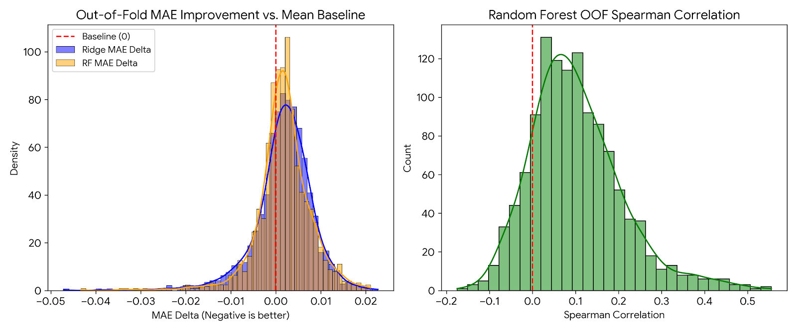

# Transcriptome-Based Drug Response Benchmark

## Project Status: Work in Progress (Preliminary Results)
An exploratory benchmark of transcriptome-based drug-response prediction under cancer-lineage holdout.

### Research Question
*Can baseline gene-expression profiles predict drug response in cancer cell lines when tested on cancer lineages not seen during training?*

### Scientific Inspiration & Literature Context
This exploratory benchmark is inspired by foundational pharmacogenomic screening studies and methodological critiques of machine learning in precision oncology:
- **High-Throughput Chemical Perturbation (PRISM):** Inspired by Corsello et al. (*Nature Cancer*, 2020), who demonstrated that pooled barcoded cell-line screening (PRISM Repurposing) can uncover non-oncology compound sensitivities coupled to baseline transcriptomic features (such as *PDE3A* expression predicting DNMDP/tepoxalin sensitivity).
- **Large-Scale Cancer Dependency & Expression Profiling (DepMap):** Built upon the Broad Institute Cancer Dependency Map framework (Tsherniak et al., *Cell*, 2017; Ghandi et al., *Nature*, 2019), utilizing standardized protein-coding RNA-seq profiles to model functional vulnerabilities across diverse cancer models.
- **Tissue Lineage as a Confounder in Drug-Response Prediction:** Motivated by methodological evaluations in pharmacogenomics showing that standard random cross-validation often yields overly optimistic performance because models memorize tissue-of-origin transcriptional signatures rather than compound-specific mechanisms. To test true out-of-distribution generalization, this project implements strict cancer-lineage holdout (`GroupKFold` by `OncotreeLineage`) against a naive training-fold mean baseline.

### Methodology & Validation Design
- **Expression Data:** DepMap protein-coding gene expression (TPM+logp1).
- **Drug Response:** PRISM Repurposing 19Q4 AUCs (`prism_auc_matrix_resolved.csv`).
- **Cross-Validation:** Evaluated using five-fold `GroupKFold` splitting by `OncotreeLineage` (`scripts/full_benchmark.py`), testing generalization to held-out lineages.
- **Models:** Mean Baseline, Ridge Regression, Random Forest (100 estimators).
- **Feature Selection:** Top 1,000 highest-variance genes fitted on outer-training splits inside a scikit-learn `Pipeline`.

### Data Preprocessing & Duplicate Resolution
The `prism_auc_matrix_resolved.csv` matrix was generated using a conservative exclusion policy prioritizing the `MTS010` screen ID and excluding ambiguous duplicate pairs (`scripts/resolve_prism_replicates.py` and `scripts/make_matrix.py`).

### Preliminary Results
The benchmark was executed across a 1,198-compound eligible panel. The results are precomputed in `full_benchmark_results.csv`.

**Summary Statistics:**
- Mean Baseline OOF MAE: ~0.1229
- Mean Ridge OOF MAE: ~0.1246
- Mean Random Forest OOF MAE: ~0.1247
- Ridge beat baseline MAE: 32.3% of compounds.
- RF beat baseline MAE: 33.1% of compounds.

**Scientific Interpretation:**
The tested configurations generally did not improve MAE over the mean baseline under the reported cross-lineage evaluation. While a mean Random Forest Spearman correlation of ~0.103 was observed, this suggests a weak average rank association and does not necessarily indicate a practically useful or statistically significant ranking model. These preliminary findings highlight the difficulty of cross-lineage generalization from transcriptomics alone using these specific baseline models and validation structures, motivating further investigation comparing cross-lineage vs. within-lineage prediction and alternative feature-selection strategies.

### Known Limitations & Future Work
1. **Ridge Tuning Metric:** In the precomputed v1 run (`full_benchmark_results.csv`), Ridge hyperparameter selection (`GridSearchCV` in `scripts/full_benchmark.py`) defaulted to $R^2$, whereas MAE is the main reported comparison metric. A future MAE-tuned run (`scoring='neg_mean_absolute_error'`, outlined in `scripts/future_benchmark_template.py`) is needed to assess whether this mismatch affects the results.
2. **Resume Status Check:** In `scripts/full_benchmark.py`, the resume logic checks for `compound_id` presence without filtering by `status == 'Completed'`. Although all 1,198 compounds completed with 0 failures in v1, `scripts/future_benchmark_template.py` updates this check for future runs.
3. **Raw Data Availability:** Large raw source files (DepMap expression matrix, raw PRISM curve parameters, and `Model.csv`) are excluded from version control due to file-size limits and must be placed in `data/raw/` to re-execute the scripts from scratch.

### Repository Manifest
- `README.md`: Project overview, methodology, preliminary results, and limitations.
- `full_benchmark_results.csv`: Preserved 1,198-compound v1 out-of-fold benchmark results.
- `prism_auc_matrix_resolved.csv`: Resolved PRISM response matrix (480 cell lines × 1,502 compounds).
- `results_distribution.png`: Summary visualization of OOF MAE deltas and Random Forest Spearman correlations.
- `scripts/`: Complete collection of data auditing, replicate resolution (`resolve_prism_replicates.py`), model prototyping, benchmark execution (`full_benchmark.py`), and future v2 template (`future_benchmark_template.py`) scripts.
